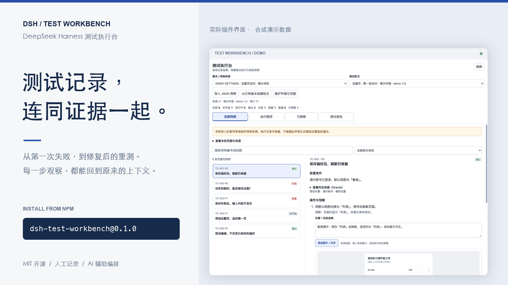
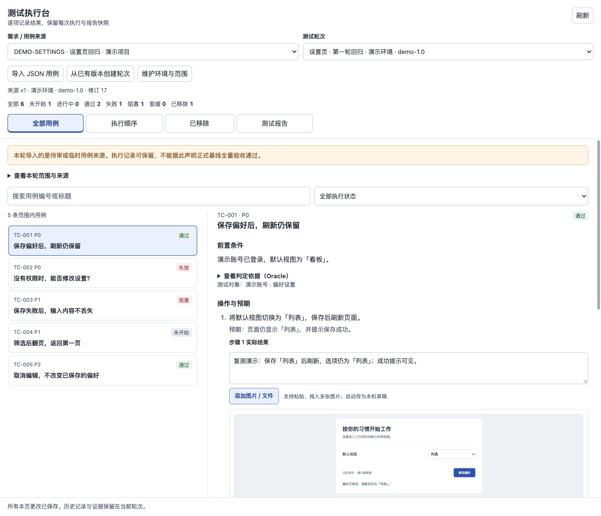
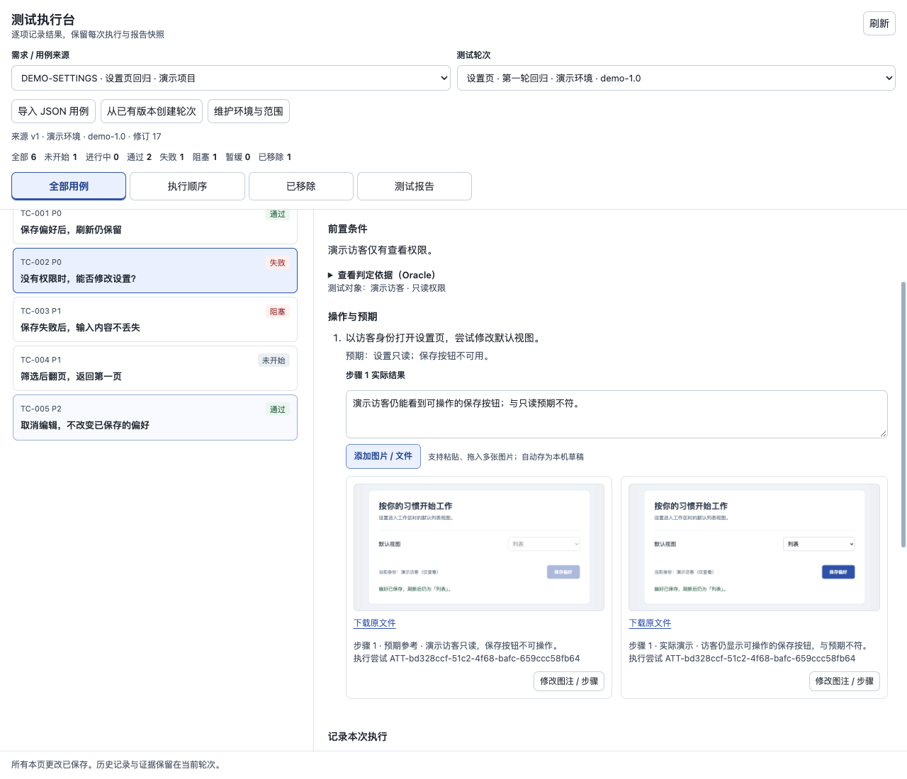
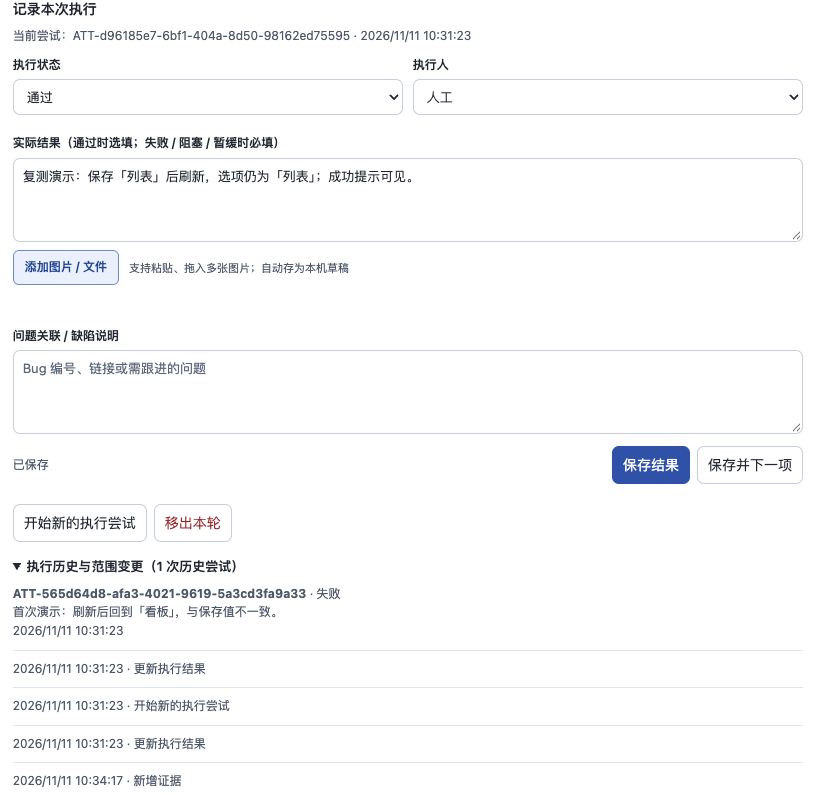
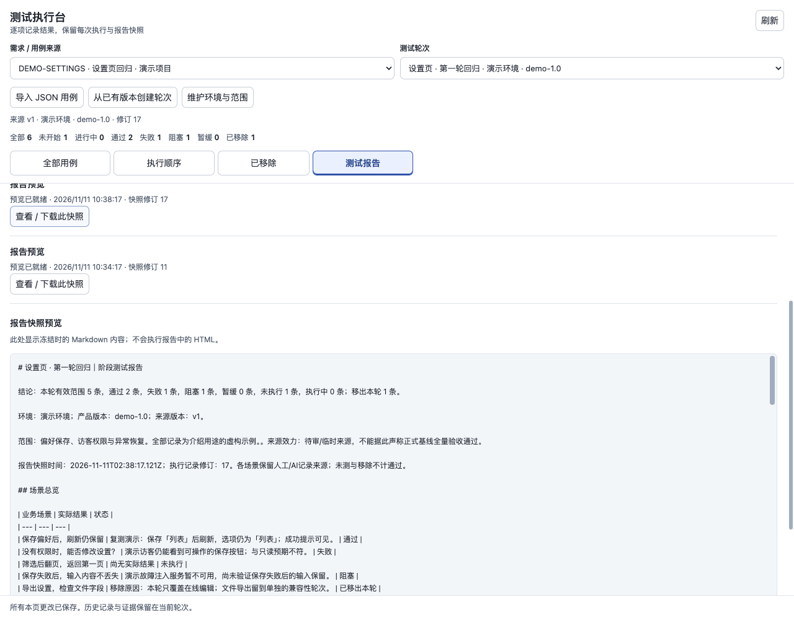

# DSH Test Workbench

**Keep the expectation, the actual result, the screenshot, and the next attempt together.**

[简体中文](README.zh-CN.md) · [npm](https://www.npmjs.com/package/dsh-test-workbench) · [Plugin marketplace](https://deepseek1024.com/plugins/lichufeng123/dsh-test-workbench) · [Configuration](docs/configuration.md)

A manual test execution workbench inside the DeepSeek Harness sidebar. QA records what happened, developers can follow the steps and evidence, and AI can help organize the round and summarize its saved results. The context stays with the case when a test fails, gets retried, or leaves the scope.

Version **0.1.0** · DSH **>=0.2.2-rc.1** · Node.js **>=22** · MIT. The current interface and report labels are in Simplified Chinese.

> All images use synthetic demo data and the actual plugin React UI in an isolated preview with a host adapter. They are not captures of a live DSH session or customer tests.

## See the whole round

Choose a source version, name the environment and tested version, and work through the case list. Six states keep passed, failed, blocked, deferred, in-progress, and unstarted work visible. Dependency-aware ordering gives the round a starting sequence; you can adjust it as the work develops.



## Put the evidence beside the step

Record each step's actual observation beside its action and expectation. Paste or drag in screenshots, add captions, and upload them to the case; videos and PDFs are supported too. Files first save as local drafts, so changing pages does not discard the attachment work. Each attachment belongs to a particular execution attempt.



## Retest without losing the first result

Start a new attempt after a fix and keep the earlier failure and its evidence available. If a case leaves the round, record why; restoring it preserves the scope history. The next person can see how the result and the scope changed.



## Share the progress you actually have

Generate a local Markdown report at any point. It keeps failures, unfinished work, removed cases, and evidence gaps visible. Each report uses a frozen snapshot, so later testing does not silently rewrite an earlier report. Preview and download work without a model or external publishing service.



## Install

Install the published npm package into the DSH CLI profile you use:

```sh
dsh plugin --profile web add dsh-test-workbench@0.1.0
```

Replace `web` with your ordinary CLI profile name. In the Desktop application's custom plugin installer, enter `dsh-test-workbench@0.1.0`; a CLI profile named `desktop` does not address the application's managed profile. The plugin runs inside DSH and needs no separate application server.

Source installation is also available: `dsh plugin --profile web add github:lichufeng123/dsh-test-workbench`.

## Try your first round

Set `workspaceRoot` to an existing test workspace in the active profile's Cordis patch:

```yaml
- id: dsh-test-workbench
  config:
    workspaceRoot: /absolute/path/to/test-project
```

Open **测试执行台** in the sidebar and import the [synthetic example](examples/cases.json), or paste an ordinary JSON object like this. A fresh workspace needs no prior case registry; each import accepts **1–500 cases**.

```json
{
  "requirement_id": "REQ-DEMO",
  "title": "Display preferences",
  "cases": [{
    "id": "C1",
    "title": "Keep a saved preference after reload",
    "steps": [
      {"action": "Choose comfortable and save", "expected": "Save succeeds"},
      {"action": "Reload the page", "expected": "Comfortable remains selected"}
    ],
    "expected_result": "The saved preference remains comfortable"
  }]
}
```

1. Select the imported source and create a round with its environment, tested version, and scope.
2. Perform the test, compare the actual behavior with your expectation, and save the status and observations.
3. Add step evidence, then explicitly upload the saved drafts to attach them to the case.
4. Open **测试报告** and choose **生成本地预览** to review or download the current snapshot.

You can also import a bare case array and fill in its source ID and title in the form. Optional `oracle` / `Oracle`, `oracles`, and `source` fields retain your project's judgment criteria and references as JSON. For example, an oracle might describe the independently prepared record that tells you what the correct saved value should be. The plugin stores these descriptions; it does not execute them or decide whether they prove a result.

Imported sources remain provisional or pending review. An `approved` field cannot turn an import into an approved baseline, and imported old results do not count as tests completed in the new round. You can use the workbench directly without adopting an upstream testing framework.

## AI assistance, with a clear role

Manual recording is the primary workflow. With an available DSH model, creating or replanning a round and generating a report can automatically invoke that model for ordering or a summary. These calls may send case descriptions or execution records to the configured model provider; there is no separate plugin model setup.

AI does not generate and run real tests here, change the expected result, or independently judge what is true. Results recorded as AI execution must reference a real execution record from the current run. The plugin itself includes no autonomous browser or business API test runner. Manual execution and local report preview remain usable without a model.

## Optional publishing and further reading

Feishu / Lark publication is **off by default**. Enable it with your own separately authenticated `lark-cli` user identity and your own report directory configuration. Version 0.1.0 also requires an available DSH model for external publication. See [configuration and publishing recovery](docs/configuration.md).

Execution records, attachment drafts, evidence, and report snapshots live under `.ai-test/` in your configured workspace; input drafts also use browser local storage. Keep this user data out of public commits. Read the [security and data boundaries](SECURITY.md) before importing sensitive material or enabling AI and publishing.

[API reference](docs/API.md) · [Contributing and local checks](CONTRIBUTING.md) · [UI design specification](docs/ui-design-spec.md) · [Changelog](CHANGELOG.md) · [MIT License](LICENSE)
