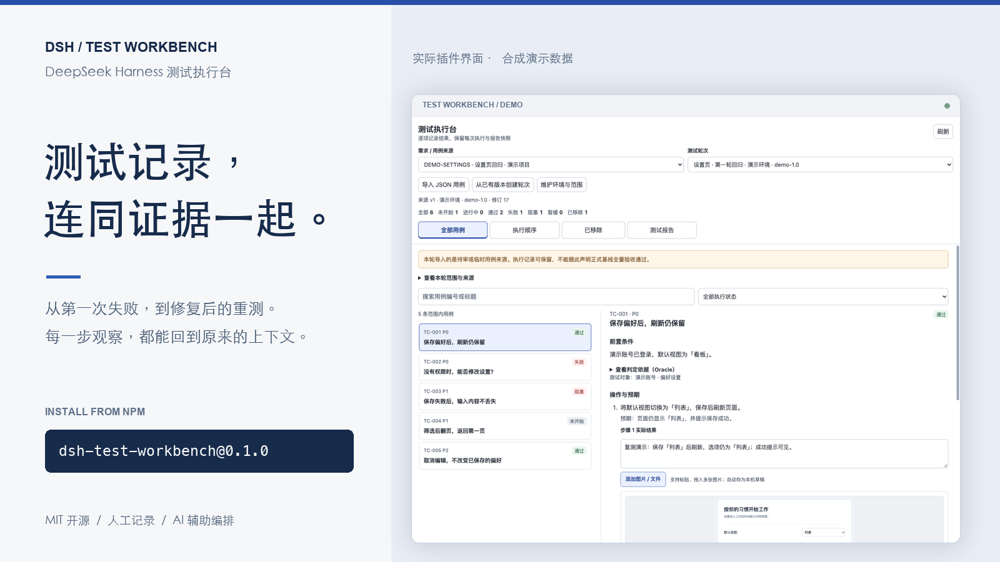
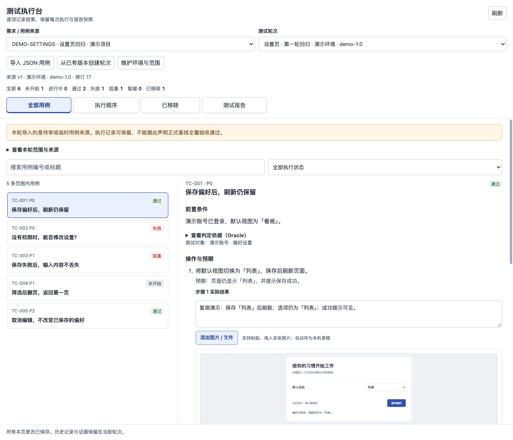
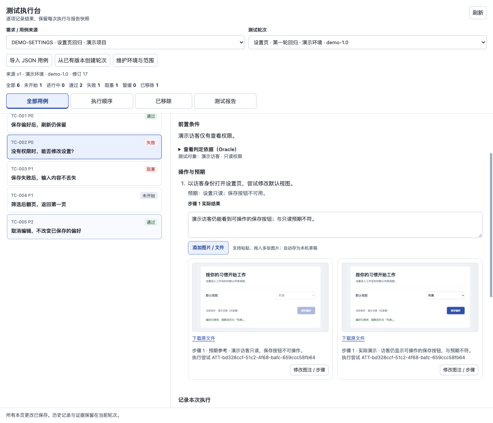
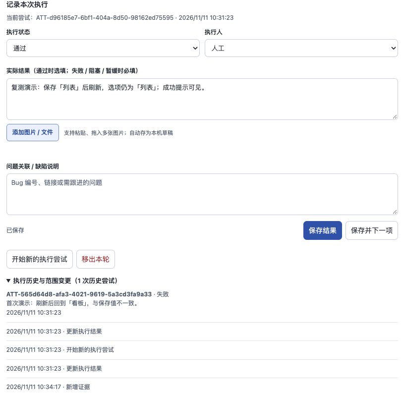
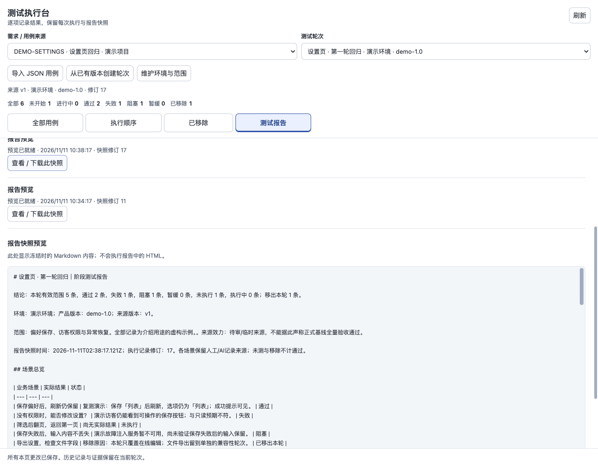

# DSH 测试执行台

**预期、实际结果、步骤截图和下一次重测，都留在同一条用例里。**

[English](README.md) · [npm](https://www.npmjs.com/package/dsh-test-workbench) · [插件市场](https://deepseek1024.com/plugins/lichufeng123/dsh-test-workbench) · [配置说明](docs/configuration.md)

在 DeepSeek Harness 侧栏完成手工测试记录。QA 留下做了什么、看到了什么，研发沿着步骤和证据理解问题，AI 协助编排顺序和概述已保存的结果。从失败、补测到范围调整，协作上下文跟着用例走。

当前版本 **0.1.0** · DSH **>=0.2.2-rc.1** · Node.js **>=22** · MIT。当前界面与报告标签使用简体中文。

> 所有图片均使用合成演示数据，展示通过宿主适配器运行的真实插件 React 界面，拍摄于隔离预览环境；不是实际 DSH 会话或客户测试现场。

## 一眼看清这轮测到哪里

选择来源版本，填写环境和被测版本，沿着用例列表逐项执行。未开始、进行中、通过、失败、阻塞、暂缓六种状态，让已完成与待跟进的工作都能看见。满足依赖的排序提供起点，也支持按实际情况人工调整。



## 截图跟着步骤，说明跟着画面

在动作和预期旁边记录每一步的实际观察，直接粘贴或拖入截图，补充图注后上传到用例；也支持视频与 PDF。附件先保存为本机草稿，切换页面后仍能继续整理。每份正式附件都关联到具体执行尝试。



## 修复后重测，第一次失败仍有迹可循

开始新的执行尝试，之前的失败和证据继续保留。临时移出本轮的用例需要说明原因，恢复时也保留范围变更历史。接手的人能看到结果如何变化，以及为什么调整测试范围。



## 没测完，也能交付说得清的进度

随时生成本地 Markdown 报告，失败、未完成、移出范围的用例和证据缺口都会如实保留。每次报告冻结当时的快照，后续补测不会悄悄改写旧报告。没有模型或外部发布服务，也能预览和下载。



## 安装

通过 npm 正式包安装到实际使用的 DSH CLI profile：

```sh
dsh plugin --profile web add dsh-test-workbench@0.1.0
```

将 `web` 换成自己的普通 CLI profile 名称。桌面应用请在自定义插件安装入口填写 `dsh-test-workbench@0.1.0`；CLI 中名为 `desktop` 的 profile 不代表桌面应用内部管理的 profile。插件运行在 DSH 内，无须另起应用服务器。

也可从源码安装：`dsh plugin --profile web add github:lichufeng123/dsh-test-workbench`。

## 开始第一轮测试

在当前 profile 的 Cordis patch 中，把 `workspaceRoot` 指向已存在的测试工作区：

```yaml
- id: dsh-test-workbench
  config:
    workspaceRoot: /absolute/path/to/test-project
```

打开侧栏 **测试执行台**，导入[合成示例](examples/cases.json)，或直接粘贴下面这样的普通 JSON。新工作区无须预先建立用例注册文件，每次可导入 **1–500 条用例**。

```json
{
  "requirement_id": "REQ-DEMO",
  "title": "显示偏好设置",
  "cases": [{
    "id": "C1",
    "title": "刷新后保留已保存的显示偏好",
    "steps": [
      {"action": "选择舒适布局并保存", "expected": "提示保存成功"},
      {"action": "刷新页面", "expected": "仍选中舒适布局"}
    ],
    "expected_result": "已保存的显示偏好保持为舒适布局"
  }]
}
```

1. 选择导入来源，创建轮次并填写环境、被测版本与范围。
2. 实际执行测试，对照预期判断，保存状态和观察结果。
3. 补充步骤证据，再明确点击上传，将草稿正式附到用例。
4. 打开 **测试报告**，点击 **生成本地预览**，查看或下载当前快照。

也支持导入纯用例数组，在表单补填来源编号与名称。可选的 `oracle` / `Oracle`、`oracles`、`source` 字段用于保留项目自己的判定依据与资料引用，支持 JSON 内容。例如，说明“正确的保存值”应以哪份独立准备的记录为准。插件保存这些说明，不执行其中的内容，也不代替执行者判断依据是否充分。

导入来源保持临时或待审效力，填写 `approved` 不会变成正式基线，旧执行结果也不算新轮次已经完成的测试。可以直接使用执行台，无须先接入上游测试框架。

## AI 协助编排与概述

执行台以人工记录为主。DSH 模型可用时，创建或重新编排轮次、生成报告可能自动调用该模型进行排序或生成概述，并把用例文本或执行记录发送给当前模型服务商，无须为插件另配模型。

AI 不在这里自动生成并执行真实测试，不修改预期，也不独立裁定结果真伪。标记为 AI 执行的结果必须引用本轮真实执行记录。插件本身没有自主操作浏览器或调用业务 API 的测试执行器。没有模型时，人工记录与本地报告预览仍可使用。

## 可选发布与更多资料

飞书发布 **默认关闭**。需要时单独安装并以自己的用户身份授权 `lark-cli`，配置自己的报告目录。`0.1.0` 的外部发布还需要可用的 DSH 模型，详见[配置与发布恢复](docs/configuration.md)。

执行记录、附件草稿、证据与报告快照保存在所配置工作区的 `.ai-test/` 下，输入草稿还使用浏览器本地存储。这些用户数据不应提交到公开仓库。导入敏感资料、使用 AI 或启用发布前，请阅读[安全说明与数据边界](SECURITY.md)。

[接口文档](docs/API.md) · [参与贡献与本地检查](CONTRIBUTING.md) · [界面规范](docs/ui-design-spec.md) · [变更记录](CHANGELOG.md) · [MIT 许可](LICENSE)
